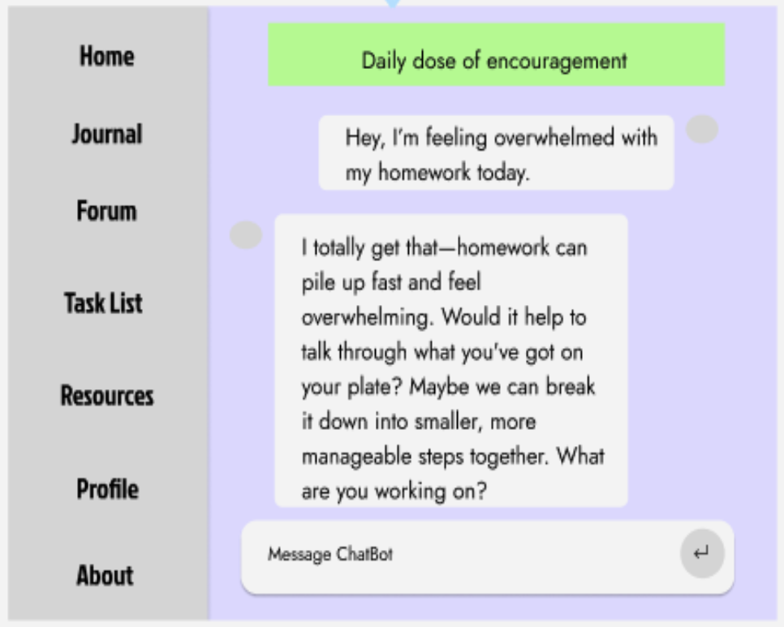
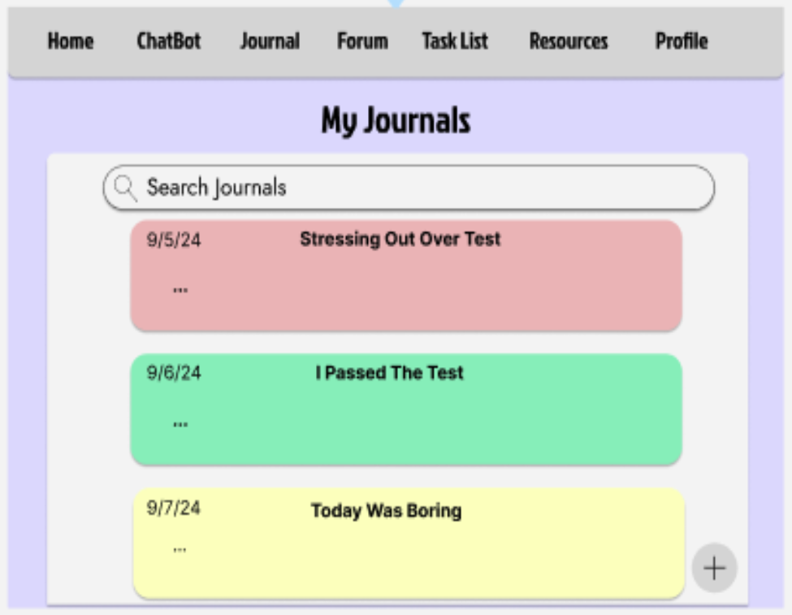
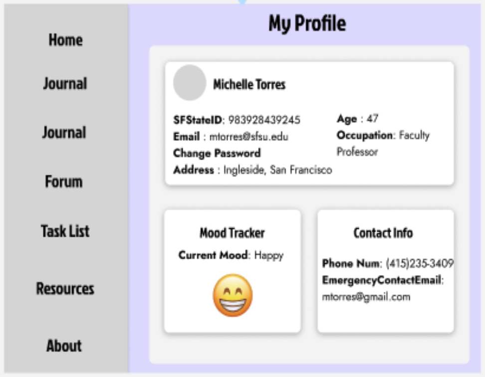
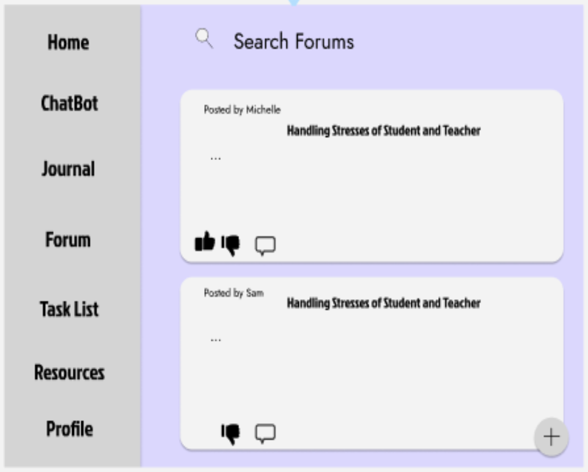
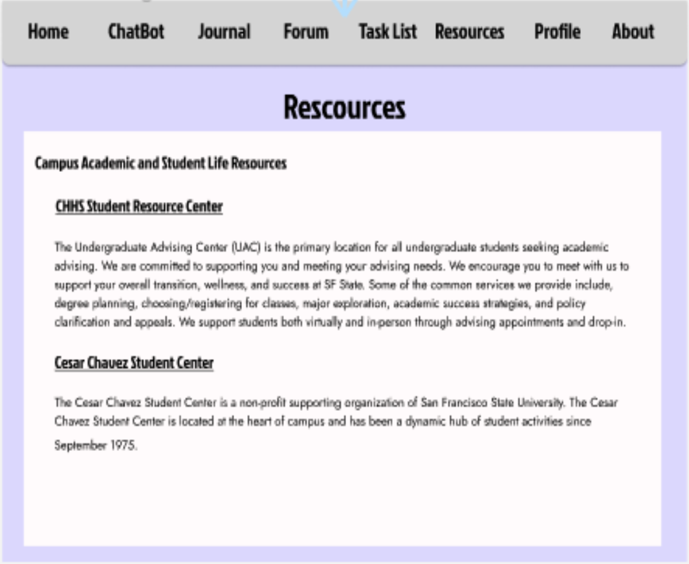

**ChillMate** is a full-stack web application designed to support stress management and well-being for students and faculty at San Francisco State University (SFSU). The platform brings together multiple tools—reflection, organization, peer interaction, and AI-assisted guidance—into a single, accessible space.  
The goal of the project is to make mental health resources easier to access in a familiar, low-pressure digital environment.

For full implementation details, documentation, and source code, please visit the GitHub repository:  
<a href="https://github.com/GioJung97/chillmate">https://github.com/GioJung97/chillmate</a>

The application is publicly accessible at: <a href="https://chillmate-react.vercel.app/">https://chillmate-react.vercel.app/</a>

> _Note: The chatbot feature is currently disabled in the public demo because it requires GPU-based model hosting, which is not available in the deployed environment._

---

## Key Features

- **AI Chatbot (RAG-based):**  
  A conversational assistant designed to provide campus-aware guidance using SFSU-specific knowledge.
  

- **Journal:**  
  A private space for users to write reflections and track emotional patterns.
  

- **Profile:**  
  A personal dashboard that summarizes user details and includes a mood tracker.
  

- **Forum:**  
  A community space for sharing experiences and peer support.
  

- **Resources:**  
  Curated wellness and mindfulness content relevant to students.
  

---

## Tech Stack

### Frontend

- React
- CSS
- Deployed on Vercel

### Backend & Data

- Node.js
- MongoDB

### AI / Chatbot System

- Open-source language model
- Retrieval-Augmented Generation (RAG) pipeline
  - Retrieves SFSU-specific documents
  - Injects relevant context into the model’s prompt
  - Enables domain-grounded, context-aware responses

---

## My Role – Scrum Master & Developer

I served as the **Scrum Master** for the team, coordinating sprint planning, stand-ups, and task distribution while ensuring smooth collaboration between frontend and backend development.

In addition to project coordination, I:

- Contributed to feature integration and frontend–backend alignment
- Helped design the chatbot system architecture
- Assisted with deployment and debugging
- Ensured the system met both functional and user-experience goals

---

## Project Context

ChillMate was developed as part of a university team project. While the chatbot system was implemented and tested locally, persistent GPU hosting was not feasible within the project’s infrastructure constraints. As a result, the AI component is currently inactive in the live deployment, though it remains part of the system design.
