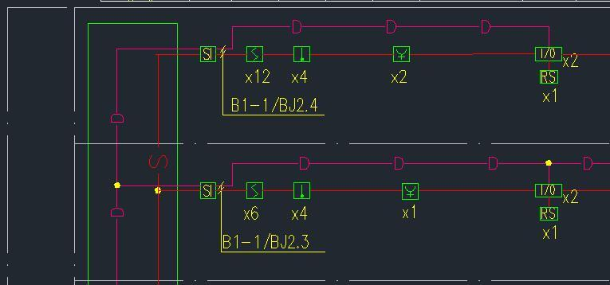
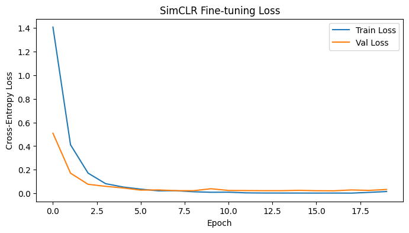
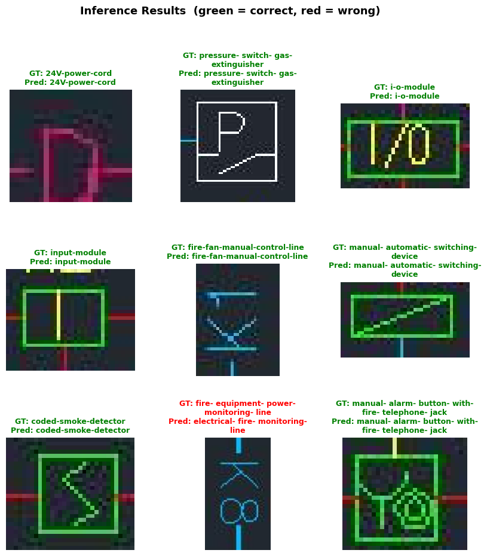

## Table of Contents

- [Overview](#overview)
- [What is SimCLR?](#what-is-simclr)
- [Dataset](#dataset)
- [Approach](#approach)
  - [Data Pipeline: From Bounding Boxes to Classification Samples](#data-pipeline-from-bounding-boxes-to-classification-samples)
  - [Model Architecture](#model-architecture)
  - [Fine-tuning Procedure](#fine-tuning-procedure)
- [Results](#results)
  - [Training Curves](#training-curves)
  - [Test Set Performance](#test-set-performance)
  - [Visual Inference Results](#visual-inference-results)
- [How to Run](#how-to-run)
- [References](#references)

---

## Overview

This project demonstrates how a **self-supervised representation learning** model (SimCLR) can be fine-tuned for a practical, real-world **multi-class object classification** task. Given scene images annotated with bounding boxes in COCO format, each annotated object is cropped out and independently classified into one of **42 firefighting device categories**.

The pipeline is end-to-end:

1. Load a **pre-trained SimCLR checkpoint** (ResNet-50 backbone, trained via contrastive learning).
2. Attach a lightweight **linear classification head** on top of the frozen/unfrozen encoder.
3. **Fine-tune** the entire model on cropped object regions using standard cross-entropy loss.
4. **Evaluate** with Top-1 / Top-5 accuracy, confusion matrix, and per-class precision/recall.
5. **Visualize** inference: each cropped object is displayed side-by-side with its ground-truth and predicted label.

---

## What is SimCLR?

**SimCLR** (Simple Framework for Contrastive Learning of Visual Representations) is a self-supervised learning framework developed by Google Research. The core idea is to learn powerful visual representations _without labels_ by training the model to recognize that two augmented views of the same image are more similar to each other than to views from different images.

**Key components:**

- **Data Augmentation**: Random cropping, color jittering, and Gaussian blur produce two correlated views of each image.
- **Base Encoder**: A deep CNN (typically ResNet) extracts representation vectors from augmented views.
- **Projection Head**: A small MLP maps representations to a space where the contrastive loss is applied.
- **NT-Xent Loss** (Normalized Temperature-scaled Cross-Entropy): Maximizes agreement between positive pairs while pushing apart negative pairs in a mini-batch.

The result is an encoder that produces rich, transferable feature representations — even though it has never seen a single label during pre-training. These representations can then be fine-tuned for downstream tasks with relatively small labeled datasets.

> **Paper**: [A Simple Framework for Contrastive Learning of Visual Representations](https://arxiv.org/abs/2002.05709) (Chen et al., 2020)
>
> **Original Repository**: [google-research/simclr](https://github.com/google-research/simclr)
>
> **PyTorch Implementation Used**: [sthalles/SimCLR](https://github.com/sthalles/SimCLR)

---

## Dataset

This project uses the **Firefighting Device Detection** dataset sourced from [Roboflow Universe](https://universe.roboflow.com/yaid-pzikt/firefighting-device-detection), annotated in **COCO format**.

| Split     |  Images | Object Annotations |
| --------- | ------: | -----------------: |
| Train     |     102 |              2,606 |
| Valid     |      28 |                755 |
| Test      |      18 |                424 |
| **Total** | **148** |          **3,785** |

Each image contains multiple firefighting devices. The dataset covers **42 object categories**, including:

> `24V-power-cord`, `acousto-optic-alarm`, `bus-isolation-module`, `coded-smoke-detector`, `fire-hydrant-button`, `i-o-module`, `manual-alarm-button-with-fire-telephone-jack`, `smoke-vent`, `water-flow-indicator`, and many more.

Each annotation provides a bounding box (`[x, y, width, height]`) and a `category_id`, which is used to crop individual objects and map them to class labels.

---

## Approach

### Data Pipeline: From Bounding Boxes to Classification Samples

Since SimCLR is an image-level representation learner (not a detector), we convert the detection dataset into a classification dataset by **cropping each annotated object** from its source image:

```python
class CocoObjectCropClassification(Dataset):
def **getitem**(self, idx):
s = self.samples[idx]
image = Image.open(os.path.join(self.images_dir, s["file_name"])).convert("RGB")

        x, y, w, h = s["bbox"]
        crop = image.crop((int(x), int(y), int(x + w), int(y + h)))

        if self.transform:
            crop = self.transform(crop)

        return crop, s["label"]

```

Each COCO annotation becomes one `(crop, label)` sample. Bounding boxes are clamped to image boundaries for robustness. A consistent `category_id -> class_index` mapping is built from the **training split only** and reused across validation, test, and inference to prevent label mismatch.

**Transforms applied:**

| Stage      | Transforms                                                    |
| ---------- | ------------------------------------------------------------- |
| Train      | `Resize(224)` &rarr; `RandomHorizontalFlip` &rarr; `ToTensor` |
| Val / Test | `Resize(224)` &rarr; `ToTensor`                               |

---

### Model Architecture

The classification model is a two-part architecture:

1. **SimCLR Backbone** (ResNet-50): Pre-trained via contrastive learning, this produces a 2,048-dimensional feature vector `h` for each input crop.
2. **Linear Classifier**: A single `nn.Linear(2048, 42)` layer maps the features to class logits.

```python
class SimCLRFinetuneClassifier(nn.Module):
    def __init__(self, simclr_model, num_classes):
        super().__init__()
        self.simclr = simclr_model
        self.classifier = nn.Linear(self.simclr.n_features, num_classes)

    def forward(self, x):
        h, _, _, _ = self.simclr(x, x)   # extract representation
        return self.classifier(h)         # classify
```

The SimCLR pre-trained checkpoint (`checkpoint_100.tar`) is loaded into the encoder **before** attaching the classification head. During fine-tuning, **all parameters** (encoder + classifier) are updated end-to-end, allowing the learned representations to adapt to the specific domain of firefighting devices.

---

### Fine-tuning Procedure

| Hyperparameter       | Value                                                  |
| -------------------- | ------------------------------------------------------ |
| Pre-trained Backbone | SimCLR ResNet-50 (100 epochs contrastive pre-training) |
| Projection Dimension | 64                                                     |
| Optimizer            | Adam                                                   |
| Learning Rate        | 1e-4                                                   |
| Loss Function        | Cross-Entropy                                          |
| Batch Size           | 32                                                     |
| Epochs               | 20                                                     |
| Input Resolution     | 224 x 224                                              |

The fine-tuning loop is straightforward supervised training:

```python
for epoch in range(20):
    # Training pass
    for x, y in train_loader:
        logits = model(x.to(device))
        loss = criterion(logits, y.to(device))
        loss.backward()
        optimizer.step()

    # Validation pass (no gradient)
    with torch.no_grad():
        for x, y in val_loader:
            logits = model(x.to(device))
            val_loss = criterion(logits, y.to(device))
```

Training converged rapidly, reaching **100% training accuracy** by epoch 11 and maintaining **~99.7% validation accuracy** from epoch 5 onward. The final model checkpoint is saved with:

- Model weights (`state_dict`)
- Optimizer state
- Category mapping (`catid_to_idx`)
- Number of classes

This self-contained checkpoint ensures reproducible inference without needing the original training annotations.

---

## Results

### Training Curves

The model converges quickly, demonstrating that SimCLR's pre-trained representations provide a strong initialization for this domain-specific task. The gap between train and validation loss remains small, indicating minimal overfitting despite the relatively small dataset size.



| Epoch | Train Loss | Train Acc | Val Loss | Val Acc |
| ----: | ---------: | --------: | -------: | ------: |
|     0 |     1.4073 |    67.84% |   0.5091 |  86.09% |
|     5 |     0.0354 |    99.39% |   0.0272 |  99.60% |
|    11 |     0.0040 |   100.00% |   0.0234 |  99.74% |
|    19 |     0.0152 |    99.46% |   0.0328 |  99.47% |

---

### Test Set Performance

On the held-out **test set** (18 images, 424 object crops):

| Metric             |      Score |
| ------------------ | ---------: |
| **Top-1 Accuracy** | **98.35%** |
| **Top-5 Accuracy** | **99.29%** |
| Weighted Precision |     98.95% |
| Weighted Recall    |     98.35% |
| Weighted F1-Score  |     98.50% |

The model achieves near-perfect classification on most of the 42 categories, with only a handful of misclassifications on rare classes with very few test samples.

---

### Visual Inference Results

Below are sample inference results showing each cropped object from test images alongside its **ground-truth label** (GT) and **predicted label** (Pred). Correct predictions are shown in green; incorrect ones in red.



---

## How to Run

Github Repo: [https://github.com/GioJung97/Fine-tune-SimCLR-with-COCO](https://github.com/GioJung97/Fine-tune-SimCLR-with-COCO)

### Prerequisites

```bash
pip install torch torchvision simclr scikit-learn matplotlib pillow
```

### Fine-tuning

Open and run `finetuning.ipynb` end-to-end. This will:

1. Load the COCO-annotated dataset from `./coco/`
2. Load the pre-trained SimCLR checkpoint from `./checkpoint/checkpoint_100.tar`
3. Train the classifier for 20 epochs
4. Save the fine-tuned model to `./finetuned_model/`

### Inference & Evaluation

Open and run `inferencing.ipynb` end-to-end. This will:

1. Load the fine-tuned checkpoint
2. Run evaluation on the test set (Top-1, Top-5, classification report)
3. Display a visual grid of cropped objects with GT vs. predicted labels

---

## References

- **SimCLR Paper**: Chen, T., Kornblith, S., Norouzi, M., & Hinton, G. (2020). _A Simple Framework for Contrastive Learning of Visual Representations_. ICML 2020. [[arXiv:2002.05709]](https://arxiv.org/abs/2002.05709)
- **SimCLR Original Repo (TensorFlow)**: [google-research/simclr](https://github.com/google-research/simclr)
- **PyTorch SimCLR Implementation**: [sthalles/SimCLR](https://github.com/sthalles/SimCLR)
- **Dataset**: [Firefighting Device Detection](https://universe.roboflow.com/yaid-pzikt/firefighting-device-detection) on Roboflow Universe (License: BY-NC-SA 4.0)
