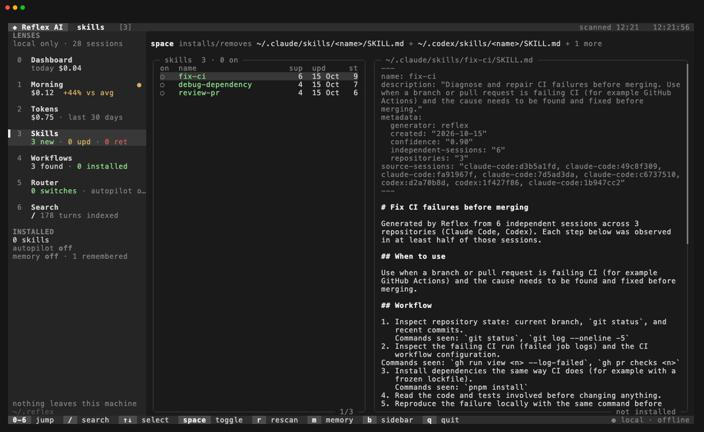

**Status:** published on npm as [`reflex-skills`](https://www.npmjs.com/package/reflex-skills) · [GitHub](https://github.com/sumervaid/reflex-tui) · MIT license

## Overview

Coding agents such as Claude Code, Codex and Cursor start every session fresh. If you fix CI the same way every week, you explain the same steps every week.

Reflex reads the session history these agents already keep on disk, finds tasks repeated in at least three independent sessions, and writes the steps they had in common into a skill: a `SKILL.md` file of reusable instructions that the agent loads in its next session. Every suggestion comes with its evidence, and nothing is installed until the user approves it. It runs entirely on the user's machine.

## My Role

Built together with Nihar Shah and Sumer Vaid. I worked on how Reflex decides that two sessions are the same task (request matching and its evaluation), on scan performance, and on the documentation and recordings.

## What I Built

### Matching requests by meaning

Word overlap cannot connect "make the login page load faster" with "the sign-in screen is really slow". I added an optional local embedding model so scans also compare sessions by meaning.

- A new embeddings package running a quantized ONNX model on WebAssembly, pinned to one revision and verified by SHA-256 before every load, so there are still no native modules and no network access outside the explicit download command.
- Intent is the maximum of the lexical and the rescaled cosine score: meaning can connect requests that share no words, but never lowers a lexical match. Same-vs-different pair AUC on the fixtures went from **0.842 to 0.922**.

### Measuring it

To change matching with evidence rather than intuition, I built labeled evaluation sets: about 75 synthetic sessions across 10 task families with deliberately confusable cases, a Korean session set, and a 238-request benchmark in 7 languages. Tests fail if the metrics regress.

Using them to rework how session vectors are built (what goes into the context document, centering on a fixed reference mean, a merge gate on cluster intent) raised AUC from **0.876 to 0.915** and cluster F1 from **0.608 to 0.704** with the same model.

### Multilingual support

The original model read English only; any two Korean requests looked alike to it. I compared e5, gte, paraphrase-multilingual, Qwen3 and bge-m3 on the 7-language benchmark and made **bge-m3** the default, keeping MiniLM as a light English-only option.

| Model | English AUC / F1 | English + Korean AUC / F1 |
| --- | --- | --- |
| MiniLM (light) | 0.915 / 0.704 | 0.730 / 0.554 |
| **bge-m3 (default)** | 0.903 / 0.707 | **0.917 / 0.747** |

Because bge-m3 needs about 2.8 GB of memory, it ships with safeguards: multi-threaded embedding (3.5× faster with bit-identical vectors), a memory and core check that recommends the light model on small machines, and time-boxed scans that resume where they stopped.

Word matching was made multilingual too: `Intl.Segmenter` for scripts without spaces, Korean particle and ending stripping, and per-language stopwords. Word-matching AUC rose from 0.610 to 0.784 for Korean, 0.500 to 0.704 for Japanese, and 0.561 to 0.779 for Chinese.

### Faster scans

- **Incremental scans.** A transcript cache keyed on file identity and the build means unchanged history is not re-parsed (on one real history, 1 of 33 files had changed but all 146 MB were being parsed again).
- **Reusing saved analysis.** `suggest` and `stats` reuse the analysis saved by `scan`: on 1,500 sessions, **30.2 s → 0.09 s**.

### Docs and recordings

I rewrote the README as a short landing page, moved reference material into its own pages, recorded the terminal UI tour and quick-start GIFs on synthetic data, and added the contributing guide, code of conduct and issue templates.

## Tech Stack

- TypeScript, Node.js, pnpm + Turborepo monorepo
- ONNX Runtime (WebAssembly), bge-m3 and all-MiniLM-L6-v2 embeddings
- SQLite for scans, traces and cached vectors
- Vitest with labeled evaluation fixtures
